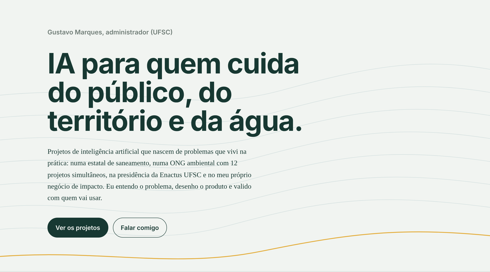

  <a href="https://gustavo-marques-da-silva.github.io/Portfolio/"><b>Ver o portfólio completo</b></a>
  &nbsp;|&nbsp;
  <a href="https://www.linkedin.com/">LinkedIn</a>

---

### Sobre

Administrador pela UFSC. Desenvolvo projetos de IA aplicada à **gestão pública**, ao **impacto socioambiental** e à **gestão de projetos**. Meu papel é entender o problema, desenhar o produto e validar a solução com quem vai usá-la.

### Em construção

**Nexo Público**: inteligência legislativa da Câmara Municipal de Florianópolis. Resume proposições, classifica por tema e responde perguntas em linguagem natural.

**GestãoIA**: IA aplicada à gestão pública.

### Propostos

| Projeto | O que faz |
|---|---|
| Tekoá SROI | Gera relatórios de SROI alinhados aos ODS para Soluções baseadas na Natureza |
| Radar de Editais | Lê editais, extrai critérios e prazos e rascunha propostas |
| GFE Assistente | Organiza as finanças de vários projetos e gera relatórios por financiador |
| Memória Enactus | Responde dúvidas de novos membros com base em documentos internos, citando a fonte |
| Trilhas por Competência | Recomenda trilhas de cursos a partir de lacunas de competência |

### Base

Gestão de projetos (Scrum e Kanban), inovação aberta, mensuração de impacto (Duke), ESG (Wharton), financiamento climático e valuation de projetos ambientais.
